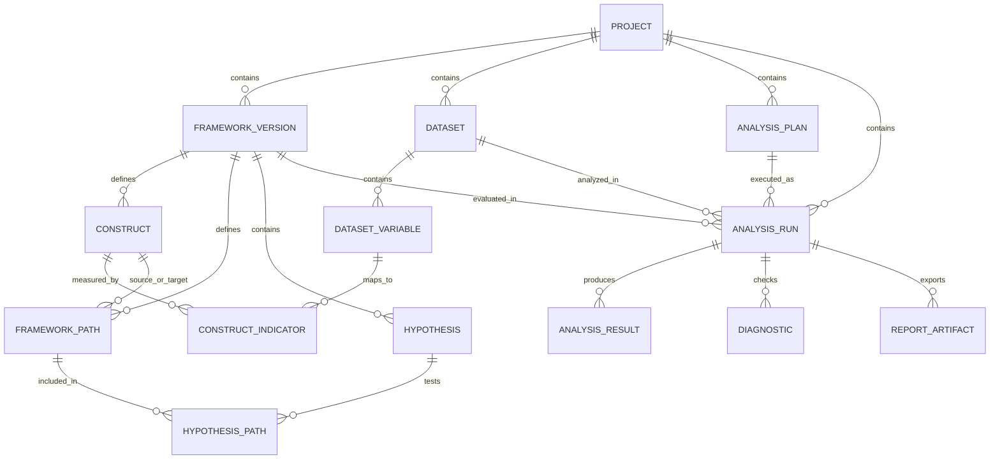

# Data Dictionary

## Purpose and Scope

This document proposes the metadata schema for the Data Analytics Hub. It covers multiple projects, conceptual frameworks, hypotheses, analysis plans, and reproducible analysis outputs. It does not define the schema of respondents' survey answers.

The initial deployment is a single-user application backed by one persistent DuckDB database. Keep uploaded source files outside the database in project-specific storage; store their relative paths and checksums here. The schema is a starting point and can be extended as supported analyses grow.

## Conventions

- Use `UUID` primary keys so records can be referenced independently of display names.
- Use `TIMESTAMPTZ` for timestamps and store them in UTC.
- Use `snake_case` for table and column names.
- Use foreign keys to associate records with their project and analysis context.
- Treat imported datasets, framework versions, analysis plans, and completed runs as immutable snapshots. Create a new version or run when they change.
- Use `JSON` for analysis-specific settings that vary by method; keep common searchable fields as regular columns.

## Relationships

## Tables

### `projects`

One research project. Each project can have multiple datasets, framework versions, plans, and runs.

| Column | Type | Required | Meaning |
|---|---|---:|---|
| `project_id` | UUID | Yes, PK | Stable project identifier. |
| `name` | VARCHAR | Yes | User-facing project name. |
| `research_question` | VARCHAR | No | Main research question or objective. |
| `description` | VARCHAR | No | Additional project notes. |
| `created_at` | TIMESTAMPTZ | Yes | Creation time in UTC. |
| `updated_at` | TIMESTAMPTZ | Yes | Most recent project metadata update. |

### `framework_versions`

A versioned conceptual framework belonging to a project. Create a new row when its constructs or paths change.

| Column | Type | Required | Meaning |
|---|---|---:|---|
| `framework_version_id` | UUID | Yes, PK | Stable framework version identifier. |
| `project_id` | UUID | Yes, FK | References `projects.project_id`. |
| `version_number` | INTEGER | Yes | Increasing version number within the project. |
| `name` | VARCHAR | Yes | Framework name. |
| `description` | VARCHAR | No | Framework rationale or scope. |
| `created_at` | TIMESTAMPTZ | Yes | Version creation time in UTC. |

Unique constraint: (`project_id`, `version_number`).

### `constructs`

Variables or theoretical constructs in one framework version, such as brand trust or purchase intention.

| Column | Type | Required | Meaning |
|---|---|---:|---|
| `construct_id` | UUID | Yes, PK | Stable construct identifier. |
| `framework_version_id` | UUID | Yes, FK | References `framework_versions.framework_version_id`. |
| `name` | VARCHAR | Yes | Short, unique name within the framework version. |
| `label` | VARCHAR | Yes | Display label. |
| `definition` | VARCHAR | No | Theoretical definition and scope. |
| `measurement_type` | VARCHAR | Yes | For example `latent`, `observed`, or `single_item`. |
| `scoring_method` | VARCHAR | No | For example `mean`, `sum`, or `none`. |
| `scoring_parameters` | JSON | No | Method-specific scoring settings. |

### `datasets`

An imported, immutable snapshot of survey data. Keep the original file in project storage; do not put respondent-level rows in this metadata table.

| Column | Type | Required | Meaning |
|---|---|---:|---|
| `dataset_id` | UUID | Yes, PK | Stable dataset snapshot identifier. |
| `project_id` | UUID | Yes, FK | References `projects.project_id`. |
| `name` | VARCHAR | Yes | User-facing dataset name. |
| `source_path` | VARCHAR | Yes | Path relative to the configured project data directory. |
| `source_format` | VARCHAR | Yes | For example `csv`, `xlsx`, or `parquet`. |
| `content_sha256` | VARCHAR | Yes | Checksum of the imported source, used to identify exact content. |
| `row_count` | BIGINT | No | Number of imported survey records. |
| `imported_at` | TIMESTAMPTZ | Yes | Import time in UTC. |

### `dataset_variables`

Column metadata for one dataset snapshot. Variable names refer to columns in that dataset, not global identifiers.

| Column | Type | Required | Meaning |
|---|---|---:|---|
| `dataset_variable_id` | UUID | Yes, PK | Stable variable mapping identifier. |
| `dataset_id` | UUID | Yes, FK | References `datasets.dataset_id`. |
| `source_name` | VARCHAR | Yes | Original column name in the imported file. |
| `label` | VARCHAR | No | Human-readable variable label. |
| `data_type` | VARCHAR | Yes | Detected or assigned type, such as `integer`, `double`, `string`, or `date`. |
| `measurement_level` | VARCHAR | No | For example `nominal`, `ordinal`, `interval`, or `ratio`. |
| `missing_value_codes` | JSON | No | Source values that should be treated as missing. |
| `column_position` | INTEGER | No | Zero-based or one-based source column position; use one convention consistently. |

Unique constraint: (`dataset_id`, `source_name`).

### `construct_indicators`

Maps survey variables to the items used to measure a construct. A construct can have multiple indicators.

| Column | Type | Required | Meaning |
|---|---|---:|---|
| `construct_indicator_id` | UUID | Yes, PK | Stable indicator mapping identifier. |
| `construct_id` | UUID | Yes, FK | References `constructs.construct_id`. |
| `dataset_variable_id` | UUID | Yes, FK | References `dataset_variables.dataset_variable_id`. |
| `item_order` | INTEGER | No | Order of the item within the scale. |
| `item_role` | VARCHAR | Yes | For example `scale_item`, `single_measure`, or `attention_check`. |
| `reverse_coded` | BOOLEAN | Yes | Whether the item must be reverse-coded before scoring. |
| `weight` | DOUBLE | No | Optional item weight; defaults to equal weighting when omitted. |

### `framework_paths`

A directed relationship between two constructs in a framework version. Mediation is represented by multiple paths through a mediator construct.

| Column | Type | Required | Meaning |
|---|---|---:|---|
| `framework_path_id` | UUID | Yes, PK | Stable path identifier. |
| `framework_version_id` | UUID | Yes, FK | References `framework_versions.framework_version_id`. |
| `source_construct_id` | UUID | Yes, FK | Construct at the start of the path. |
| `target_construct_id` | UUID | Yes, FK | Construct at the end of the path. |
| `moderator_construct_id` | UUID | No, FK | Optional construct that moderates this path. |
| `label` | VARCHAR | No | Optional diagram label. |

### `hypotheses`

A testable statement associated with a framework version. Record the researcher's hypothesis; do not generate it solely from observed results.

| Column | Type | Required | Meaning |
|---|---|---:|---|
| `hypothesis_id` | UUID | Yes, PK | Stable hypothesis identifier. |
| `framework_version_id` | UUID | Yes, FK | References `framework_versions.framework_version_id`. |
| `code` | VARCHAR | Yes | Human-readable code, such as `H1`. |
| `statement` | VARCHAR | Yes | Full hypothesis statement. |
| `expected_direction` | VARCHAR | No | For example `positive`, `negative`, or `non_directional`. |
| `rationale` | VARCHAR | No | Theoretical rationale or citation notes. |
| `purpose` | VARCHAR | Yes | `confirmatory` or `exploratory`. |

Unique constraint: (`framework_version_id`, `code`).

### `hypothesis_paths`

Associates a hypothesis with one or more framework paths. A mediation hypothesis can link its `a_path` and `b_path` paths.

| Column | Type | Required | Meaning |
|---|---|---:|---|
| `hypothesis_path_id` | UUID | Yes, PK | Stable association identifier. |
| `hypothesis_id` | UUID | Yes, FK | References `hypotheses.hypothesis_id`. |
| `framework_path_id` | UUID | Yes, FK | References `framework_paths.framework_path_id`. |
| `path_role` | VARCHAR | No | Role in the hypothesis, such as `direct`, `a_path`, `b_path`, or `c_prime`. |
| `sequence_order` | INTEGER | No | Order used to display or interpret paths. |

### `analysis_plans`

A saved, project-scoped specification for an intended analysis. Create a new plan rather than overwriting one used by a completed run.

| Column | Type | Required | Meaning |
|---|---|---:|---|
| `analysis_plan_id` | UUID | Yes, PK | Stable plan identifier. |
| `project_id` | UUID | Yes, FK | References `projects.project_id`. |
| `name` | VARCHAR | Yes | User-facing plan name. |
| `method` | VARCHAR | Yes | For example `linear_regression`, `logistic_regression`, or `mediation`. |
| `purpose` | VARCHAR | Yes | `confirmatory` or `exploratory`. |
| `specification` | JSON | Yes | Method-specific variable roles, covariates, and model settings. |
| `missing_data_policy` | VARCHAR | No | Planned handling of missing observations. |
| `created_at` | TIMESTAMPTZ | Yes | Plan creation time in UTC. |

### `analysis_runs`

An execution of an analysis plan against specific immutable inputs. Each rerun creates a new record.

| Column | Type | Required | Meaning |
|---|---|---:|---|
| `analysis_run_id` | UUID | Yes, PK | Stable run identifier. |
| `project_id` | UUID | Yes, FK | References `projects.project_id`. |
| `dataset_id` | UUID | Yes, FK | References `datasets.dataset_id`. |
| `framework_version_id` | UUID | Yes, FK | References `framework_versions.framework_version_id`. |
| `analysis_plan_id` | UUID | Yes, FK | References `analysis_plans.analysis_plan_id`. |
| `status` | VARCHAR | Yes | For example `queued`, `running`, `succeeded`, or `failed`. |
| `input_snapshot_hash` | VARCHAR | No | Hash identifying the complete inputs and settings used. |
| `software_versions` | JSON | No | Python and relevant package versions. |
| `random_seed` | BIGINT | No | Seed for stochastic procedures such as bootstrap resampling. |
| `started_at` | TIMESTAMPTZ | No | Run start time in UTC. |
| `completed_at` | TIMESTAMPTZ | No | Run completion time in UTC. |
| `error_summary` | VARCHAR | No | Concise error information for failed runs. |

### `analysis_results`

One reported estimate or model statistic from a run. Keep unrounded numeric values; round only for display and export.

| Column | Type | Required | Meaning |
|---|---|---:|---|
| `analysis_result_id` | UUID | Yes, PK | Stable result identifier. |
| `analysis_run_id` | UUID | Yes, FK | References `analysis_runs.analysis_run_id`. |
| `result_kind` | VARCHAR | Yes | For example `coefficient`, `indirect_effect`, or `model_statistic`. |
| `term` | VARCHAR | Yes | Term name, such as a predictor, interaction, or indirect effect. |
| `estimate` | DOUBLE | No | Estimated value. |
| `standard_error` | DOUBLE | No | Standard error, when applicable. |
| `statistic` | DOUBLE | No | Test statistic, when applicable. |
| `p_value` | DOUBLE | No | P-value, when applicable. |
| `confidence_level` | DOUBLE | No | Confidence level, e.g. `0.95`. |
| `confidence_lower` | DOUBLE | No | Lower confidence bound. |
| `confidence_upper` | DOUBLE | No | Upper confidence bound. |
| `sample_size` | BIGINT | No | Number of observations used for this result. |
| `details` | JSON | No | Method-specific values, such as bootstrap interval details. |

### `diagnostics`

Assumption checks, data quality findings, and warnings associated with a run. A warning should not be silently treated as a failed hypothesis test.

| Column | Type | Required | Meaning |
|---|---|---:|---|
| `diagnostic_id` | UUID | Yes, PK | Stable diagnostic identifier. |
| `analysis_run_id` | UUID | Yes, FK | References `analysis_runs.analysis_run_id`. |
| `check_code` | VARCHAR | Yes | Stable identifier for the check, such as `multicollinearity`. |
| `status` | VARCHAR | Yes | For example `pass`, `warning`, `fail`, or `not_applicable`. |
| `message` | VARCHAR | Yes | User-facing interpretation. |
| `value` | JSON | No | Numeric or structured check result. |

### `report_artifacts`

Files exported from a completed run, such as tables, plots, or a report.

| Column | Type | Required | Meaning |
|---|---|---:|---|
| `report_artifact_id` | UUID | Yes, PK | Stable artifact identifier. |
| `analysis_run_id` | UUID | Yes, FK | References `analysis_runs.analysis_run_id`. |
| `artifact_type` | VARCHAR | Yes | For example `html_report`, `csv_table`, or `png_figure`. |
| `file_path` | VARCHAR | Yes | Path relative to the configured project data directory. |
| `content_sha256` | VARCHAR | No | Checksum for verifying the exported file. |
| `created_at` | TIMESTAMPTZ | Yes | Export time in UTC. |

## Initial Implementation Notes

- Keep each project's files under a configured data directory, using the `project_id` in its folder name. Do not rely on the current working directory for paths.
- Preserve original uploads. If files are normalized for analysis, store the normalized copy as a separate versioned artifact and record its lineage.
- Validate that every construct indicator references a variable from the dataset being analyzed. Dataset variables are dataset-specific.
- Validate that framework paths only connect constructs from the same framework version, and that hypotheses only reference paths from that version.
- Store exact settings and software versions for each run. Reports should distinguish exploratory from confirmatory analysis and display diagnostics and limitations.
- This schema is intentionally focused on a first version. Respondent-level access controls, shared workspaces, and concurrent editing are out of scope for the initial single-user application.